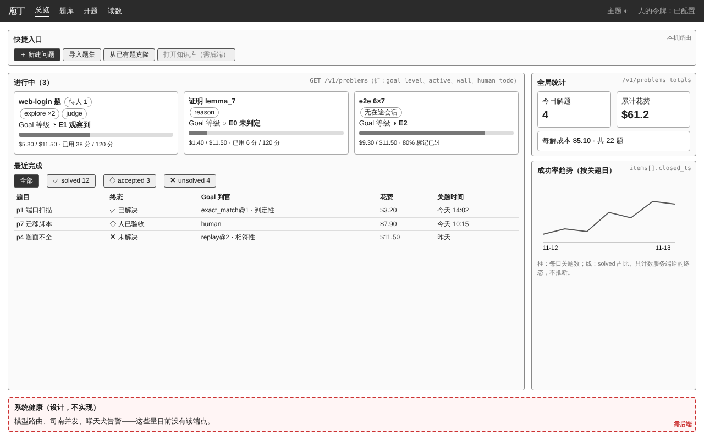
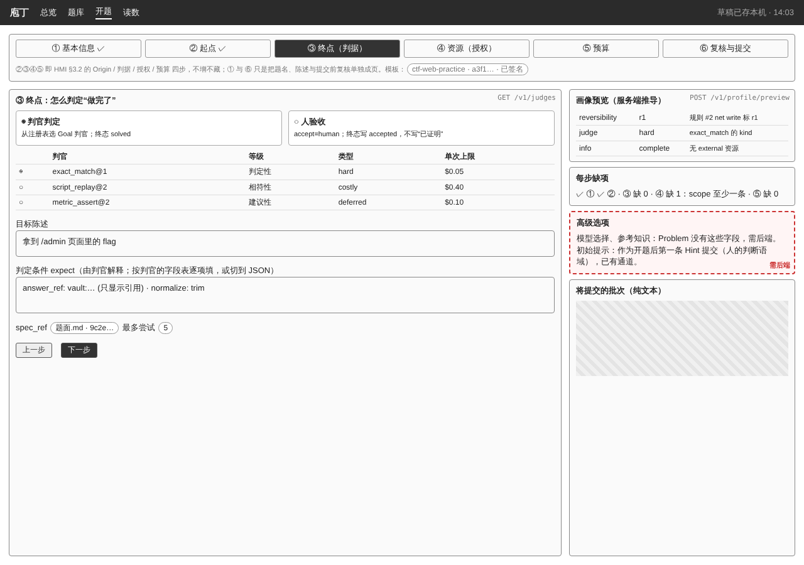
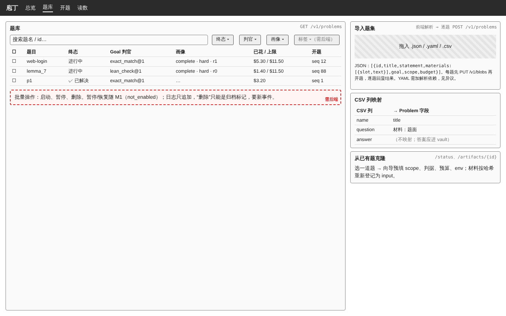
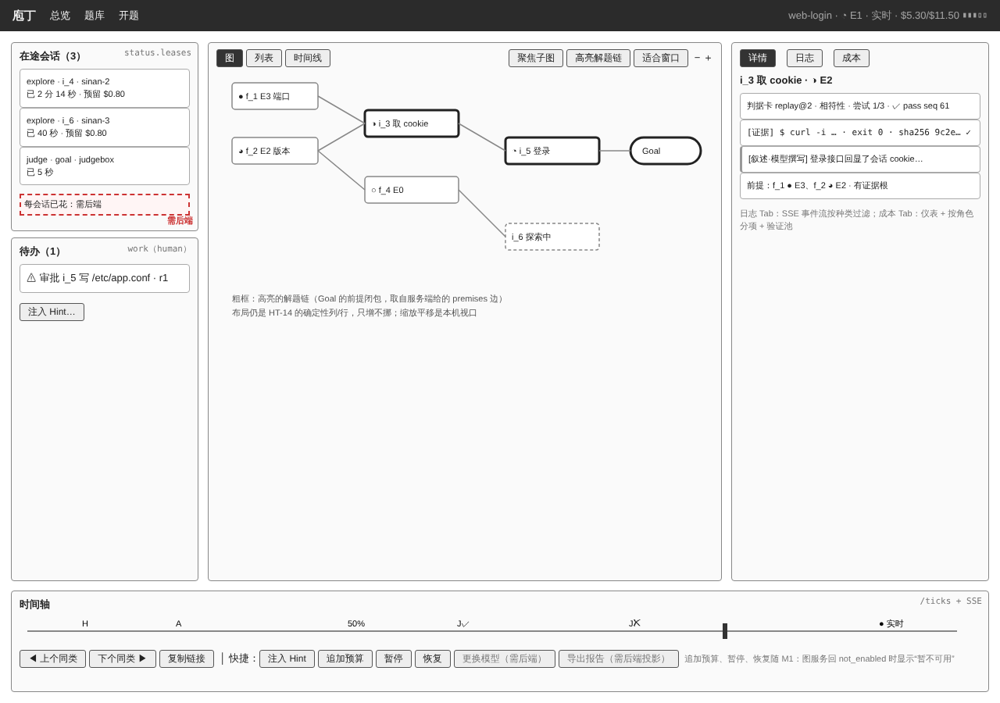
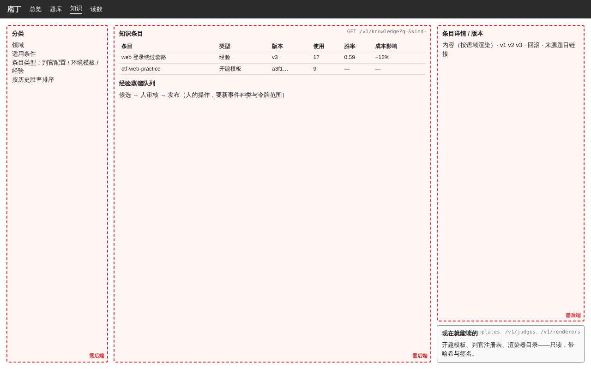
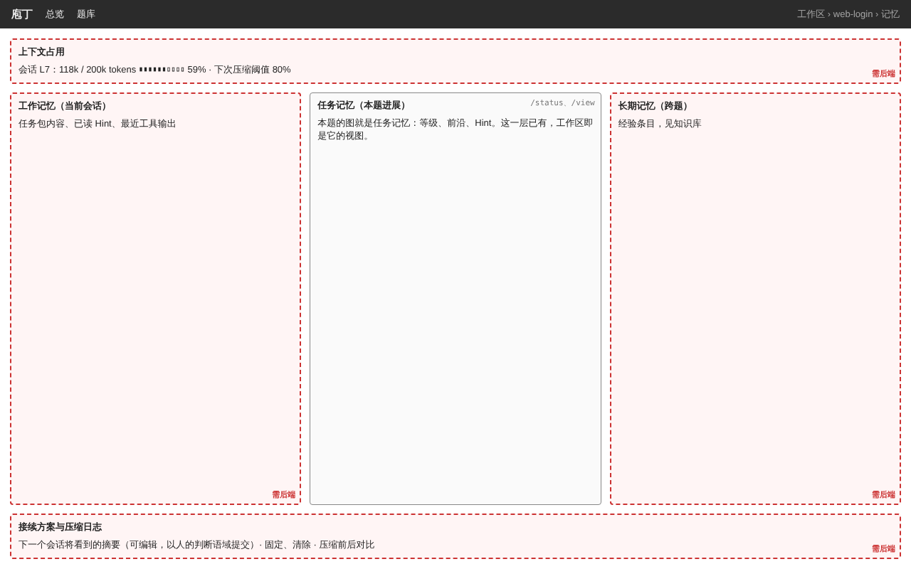
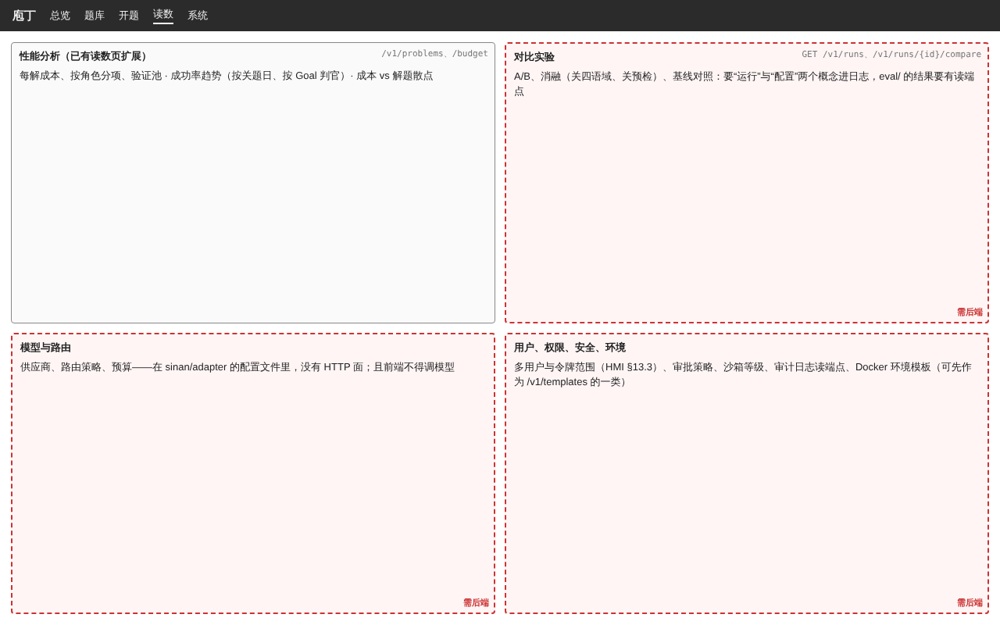
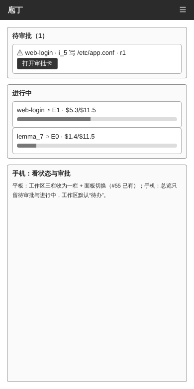

# 庖丁工作台：前端产品级重设计 v1

状态：设计稿，2026-11-18。需求来自 cz 的“前端产品级重设计——从工程验证到完整工作台”。
上位约束：HMI 设计 v1.1（`hmi-design-v1.md`，下称 HMI）、`web/SPEC.md`、`graph/SPEC.md` 的 HTTP 绑定。
线框：`web-workbench/*.png`（源文件 `web-workbench/wireframes.html`，`cd web && node ../docs/design/web-workbench/shoot.mjs` 重新出图）。
与 HMI 有出入的取值写在异议 `docs/m0/dissent-web-workbench.md`，等 cz 裁决；本文按其中的“建议”一栏设计。

---

## 0. 一页结论

1. **七个模块里，三个本轮实现，四个只出设计。** 仪表盘、开题向导（含导入、克隆、题库筛选）、增强工作区要的数据，图服务现在几乎都有，只缺 `/v1/problems` 每行的几个字段（§6 的 A 组，读侧增量）。知识库、长会话记忆、对比实验、系统管理要的是新的后端概念（知识条目、上下文占用、运行与配置、用户与令牌范围），前端不造假数据，本轮只画线框、列端点（§6 的 C 组）。
2. **HMI 的五条禁令全部保留。** 工作台仍是日志的读者：不算等级、不持有权威状态、写只走提议通道、不调模型、文本一律纯文本。需求里与之冲突的几处（向导里的“模型选择”“更换模型”、批量“删除”、前端算“阶段”）按禁令改写，改写方式见 §1。
3. **技术栈不加重依赖。** 状态管理沿用 `useSyncExternalStore` 的会话对象（与 Zustand 同一模式，不加包）；图沿用自绘 SVG，在现有的缩放平移键盘之上加“聚焦子图”“高亮解题链”；不引 UI 组件库，改用 CSS 变量做亮色、暗色、高对比三套主题。理由与替代方案见异议第 1 条。
4. **三个模块各一个 PR，按序叠放**：仪表盘（含导航外壳与主题）→ 开题向导与题库 → 增强工作区。只用假后端与假 CLI，不碰真模型。

---

## 1. 需求逐条落位

记号：**做** = 本轮实现；**改写** = 按禁令换一种做法实现；**设计** = 只出线框与端点；**M1** = 端点已在、图服务回 `not_enabled`，界面如实显示“暂不可用”。

| 模块 | 需求 | 落位 | 说明 |
| --- | --- | --- | --- |
| 一 仪表盘 | 进行中卡片：题名、阶段、等级、成本、用时 | 做 + 改写 | “阶段”不由前端推断，直接列出在途租约的 kind（bootstrap / reason / explore / judge），这是服务端事实；等级取 Goal 的等级 |
| | 最近完成按终态分类 | 做 | solved / accepted / unsolved 三值来自服务端 |
| | 今日解题、累计成本、成功率趋势 | 做 | 计数服务端给的 `terminal` 与 `closed_ts`，按本机时区分日；不推断任何等级 |
| | 快捷入口 | 做 | 新建、导入、克隆；“知识库”入口在端点落地前不出现 |
| 二 问题 | 六步向导 | 改写 | HMI 规定四步不增不藏；建议把“基本信息”“复核”拆成独立页，中间四步仍是 Origin / 判据 / 授权 / 预算（异议第 2 条） |
| | 起点：文件、文本、链接、环境描述 | 做 | 文本与链接作为纯文本 Blob 登记为 input 类；链接不抓取；环境描述填 `env.base` / `baseline_ref` |
| | 终点：精确匹配 / 脚本重放 / 人验收 | 做 | 前两者是判官注册表里的条目（按 kind 与 grade 展示），人验收是 `accept: human` |
| | 资源：目标环境、环境模板 | 做 | 目标环境即 scope 规则（逐条标风险）+ `env`；环境模板复用 `/v1/templates` |
| | 预算：成本、时间、判定预算占比 | 做 | `usd_milli`、`wall_s`、`verify_share`、`bootstrap_share` |
| | 高级：模型选择、初始提示词、参考知识 | 改写 / 设计 | 初始提示词 = 开题后立刻提交的第一条 Hint（人的判断语域，已有通道）；模型选择、参考知识要 Problem 新字段，设计 |
| | 导入 YAML / JSON / CSV 列映射 | 做（JSON、CSV）| 前端解析，逐题走与向导相同的 `PUT /v1/blobs` + `POST /v1/problems`；YAML 要解析依赖，见异议第 1 条 |
| | 从已有项目克隆 | 做 | 读原题 `/status` 预填；材料按哈希重新登记为 input 类 |
| | 题库筛选、搜索 | 做（部分）| 终态、判官、画像、题名搜索；标签、难度、领域要 Problem 新字段，设计 |
| | 批量启动、暂停、删除 | M1 / 设计 | 暂停恢复随 M1；日志只追加，“删除”只能是归档事件，设计 |
| 三 工作区 | 图 / 列表 / 时间线三视图 | 做 | 列表 = 现有前沿列表加按等级分组；时间线视图 = 刻度表成行，点任意一行即回放到该 seq |
| | 图：着色、缩放平移、聚焦子图、高亮解题链 | 做 | 缩放平移键盘已有（#55）；聚焦与高亮沿服务端给的 `premises` 边取闭包，只改样式不改布局（HT-14） |
| | 左：在途会话、待办 | 做 | `status.leases` 与 `work` 的 human 项；每会话已花要新字段（A 组） |
| | 右 Tab：详情 / 日志 / 成本 | 做 | 详情 = 现有检视；日志 = SSE 事件流按种类过滤；成本 = 仪表 + 按角色分项 + 验证池 |
| | 底部时间轴 + 快捷操作栏 | 做 | 时间轴已有；快捷栏：注入 Hint、追加预算（M1）、暂停恢复（M1） |
| | Hint 引用节点、设优先级 | 做 / 设计 | `about` 已有；Hint 没有优先级字段，设计 |
| | 审批卡、终止会话、更换模型、修改优先级 | 做 / 设计 | 审批卡已有；终止会话、改模型、改优先级都不是人的操作表里的操作，设计 |
| | 面板可自定义 | 做 | 左右栏可收起、宽度三档，存本机 `localStorage`，不影响派生量 |
| | 导出回放报告、多次运行对比 | 设计 | 报告必须是服务端投影（HMI 一卡多端）；“运行”概念不在日志里 |
| 四 知识 | 知识库、蒸馏、训练数据 | 设计 | 现在能只读展示的只有模板、判官、渲染器三份目录 |
| 五 记忆 | 上下文占用、分层、接续摘要 | 设计 | 任务记忆层就是本题的图，已有；工作记忆与长期记忆要 adapter 上报 |
| 六 分析 | 趋势、成本效率、外壳税、A/B、消融、基线 | 做（部分）/ 设计 | 读数页加趋势与散点；外壳税、对比要 eval/ 结果的读端点 |
| 七 系统 | 模型、用户、安全、环境 | 设计 | 都没有 HTTP 面；多用户见 HMI §13.3 |
| 原则 | 亮色 / 暗色 / 高对比 | 做 | CSS 变量三套；跟随系统，可手动切换，存本机 |
| 原则 | 桌面 / 平板 / 手机 | 做 | 平板沿用 #55 的单栏切换；手机总览只留待审批与进行中 |

---

## 2. 信息架构与路由

路由仍是手写的小模块（`web/src/app/router.ts`），状态全在 URL。新增的路由加粗；“设计”的路由本轮不注册，导航里也不出现。

| 路由 | 页面 | 本轮 |
| --- | --- | --- |
| **`/`** | 总览（仪表盘）| 做；原题目列表移到 `/problems` |
| **`/problems?q=&terminal=&judge=`** | 题库：筛选、搜索、勾选 | 做 |
| `/new` | 开题向导；**`?step=`** 记住步骤，**`?from=<pid>`** 克隆 | 做 |
| **`/import`** | 导入题集（JSON、CSV 列映射）| 做 |
| `/p/<pid>?as_of=&node=` + **`&view=graph｜list｜timeline&tab=detail｜log｜cost`** | 工作区 | 做 |
| `/readings` | 读数（性能分析）| 做（加趋势）|
| `/p/<pid>/report` | 回放报告 | 设计 |
| `/p/<pid>/memory` | 记忆面板 | 设计 |
| `/compare?runs=` | 对比实验 | 设计 |
| `/knowledge`、`/knowledge/<id>`、`/distill`、`/datasets` | 知识、蒸馏、训练数据 | 设计 |
| `/settings/{models,users,security,envs}` | 系统管理 | 设计 |

导航：总览 · 题库 · 开题 · 读数；右侧主题切换与人的令牌。

## 3. 组件层级

```
App
├─ Shell（导航、主题切换 ThemeSwitch、TokenBox、窄屏菜单）
├─ Dashboard                         /
│  ├─ QuickActions
│  ├─ RunningCards → RunningCard（LeaseChips、LevelBadge、CostMeter 小号、WallClock）
│  ├─ RecentTable（TerminalFilter）
│  └─ StatsPanel（StatTile×3、TrendChart：每日关题柱 + solved 占比线）
├─ ProblemBank                       /problems
│  ├─ BankFilters（搜索、终态、判官、画像）
│  └─ BankTable（勾选；批量操作条：M1 前只有“打开”“克隆”）
├─ Wizard                            /new
│  ├─ StepNav（六页，每页缺项数）
│  ├─ BasicsStep / OriginStep（MaterialSlot：文件｜文本｜链接）/ CriterionStep（JudgeTable、AcceptChoice、ExpectEditor）
│  │  / ScopeStep（ScopeTable、EnvFields）/ BudgetStep / ReviewStep（ProfilePreview、BatchPreview、InitialHint）
│  └─ DraftStore（本机草稿，localStorage）
├─ Import                            /import
│  ├─ FileDrop → JsonImport | CsvImport（ColumnMapper）
│  └─ ImportQueue（逐题状态：上传、开题、拒绝码）
├─ Workspace（原 Cockpit）            /p/<pid>
│  ├─ TopBar（已有）
│  ├─ LeftPanel：SessionList（LeaseRow）、Todo（已有）
│  ├─ CenterView：GraphView（+ FocusControls）｜ FrontierList（+ 按等级分组）｜ EventTimelineList
│  ├─ RightPanel：Tabs → Inspector（已有）｜ EventLog（种类过滤）｜ CostPanel（CostMeter + ByKindTable + VerifyPool）
│  ├─ Sheets：ApprovalCard、ExtensionDialog、HintInject、HintTraceCard（均已有）
│  └─ BottomBar：Timeline（已有）+ QuickActions（Hint、追加预算、暂停、恢复）
└─ Readings（已有，加 TrendChart）
```

状态：
- 题内仍是 `ProblemSession`（`useSyncExternalStore`）；新增的总览用一个同形的小 store 轮询 `/v1/problems`（每 5 秒，页面不可见时停）。
- 本机偏好（主题、面板宽度、中心视图、右侧 Tab、向导草稿）统一放 `app/config.ts` 的 `prefs`，都不进任何请求。

## 4. 线框

| 图 | 内容 |
| --- | --- |
|  | 总览：快捷入口、进行中卡片、最近完成、全局统计与趋势 |
|  | 向导第 ③ 页：判定方式二选一、判官表、expect、画像预览、高级选项的落位 |
|  | 题库、导入、CSV 列映射、克隆 |
|  | 工作区：在途会话与待办、三视图、详情/日志/成本、时间轴与快捷栏 |
|  | 知识库与经验蒸馏（设计）|
|  | 长会话记忆（设计）|
|  | 分析、对比实验、系统管理（设计）|
|  | 手机：待审批与进行中 |

红色虚线框 = 需要后端新能力，本轮不实现。

## 5. 横切取值

- **主题。** `:root` 上一套语义色变量（底、面、线、字、弱字、强调、等级 E0–E3/X、终态三值、警示）；`[data-theme=dark]`、`[data-theme=contrast]` 各覆盖一套；缺省跟随 `prefers-color-scheme`。等级与终态继续“形状记号 + 文字”，颜色只是第三重编码，所以高对比主题里去掉底色也不丢信息。
- **实时。** 总览轮询 `/v1/problems`（无全局 SSE；见 §6 B-3）；题内沿用 SSE + `view` 帧。所有写操作提交后显示“已提交 seq=…”或拒绝码，不做乐观更新。
- **图。** 布局函数不动（HT-14：列 = 1 + 前提最大列，只增不挪）。聚焦子图 = 选中节点的前提闭包与后继闭包之外的节点淡出；高亮解题链 = Goal 判据所挂候选的前提闭包；两者只改样式。节点超过 50 才默认开图的规则保留。
- **响应式。** ≥ 1280 三栏；1024–1279 右栏可收起；< 1024 单栏 + 面板切换（#55）；< 600 总览只显示待审批与进行中。
- **可审计。** 每个写操作的结果行带 seq，点开即回放到该 seq；导入队列逐题保留请求与应答。

## 6. 后端对接清单

### A 组：本轮需要的读侧增量（随仪表盘 PR 一起做，graph 侧加测试）

| 端点 | 增量 | 用途 |
| --- | --- | --- |
| `GET /v1/problems` | 每行加 `closed_ts`、`goal_level`、`active`（在途租约的 `{kind, target}` 列表）、`human_todo`（待人处理项数）、`wall {cap_s, elapsed_s}` | 进行中卡片、今日解题、趋势；免去每题一次 `/snapshot` |

都是现有投影的字段搬运，不新算任何量；`view_hash` 照常覆盖。

### B 组：已有端点，本轮直接用

`/v1/problems`、`/snapshot`、`/ticks`、`/stream`、`/status|view|budget|work`、`/nodes/{id}`、`/cards/{kind}/{id}`、`/hints/{id}/trace`、`/artifacts/{id}`、`/blobs`、`/judges`、`/templates`、`/renderers`、`/profile/preview`、`POST /v1/problems`、`POST …/proposals`（`hint`、`approve`、`budget_add`、`pause`、`resume`；后三者 M0 回 `not_enabled`）。

B-3（不做，记一笔）：全局事件流 `GET /v1/stream`（所有题的 `view` 帧）可替代总览轮询，题多了再说。

### C 组：需要新的后端能力（本轮只设计）

| # | 端点（草案）| 模块 | 要的后端概念 | 写还是读 |
| --- | --- | --- | --- | --- |
| C1 | `GET /v1/problems/{pid}/leases/{id}/spend` 或 `leases[].spent` | 工作区 | 按租约归集的花费 | 读 |
| C2 | `GET /v1/problems/{pid}/budget/series?step=` | 工作区 成本 | 花费随 seq 的序列（服务端从事件折叠）| 读 |
| C3 | Problem 加 `labels {tags[], difficulty?, domain?}` | 题库 | 内核 Schema 增量（不进等级与画像）| 写（随开题）|
| C4 | `archive_problem` 人的操作 | 题库 | 只追加日志里的“删除” | 写 |
| C5 | Hint 加 `priority` | 工作区 | 任务包里 Hint 的排序依据 | 写 |
| C6 | `GET /v1/problems/{pid}/report` | 回放报告 | 与 `pd report` 同源的结构化投影 | 读 |
| C7 | `GET /v1/runs`、`/v1/runs/{id}`、`/v1/runs/compare?a=&b=` | 对比、消融、基线、外壳税 | “运行”与“配置”进日志；eval/ 的结果落盘格式 | 读 |
| C8 | `GET /v1/knowledge?q=&kind=`、`/v1/knowledge/{id}/versions`、`POST /v1/knowledge`（人的操作）| 知识库 | 知识条目、版本、使用与胜率统计 | 读 + 写 |
| C9 | `GET /v1/distill/candidates`、`approve_lesson` / `reject_lesson` | 经验蒸馏 | 候选经验与审核事件 | 读 + 写 |
| C10 | `/v1/datasets`、`/v1/trainings/{id}` | 训练数据 | 数据集版本、训练任务 | 读 + 写 |
| C11 | `GET /v1/leases/{id}/context`（tokens、上限、压缩日志）| 记忆 | adapter 上报上下文占用 | 读 |
| C12 | `POST …/proposals` 的 `pin_memory`、`handoff_note` | 记忆、会话接续 | 接续摘要作为人的判断进任务包 | 写 |
| C13 | Problem 加 `prefs {model?, refs[]}` 或司南侧按题配置 | 向导高级、更换模型 | 模型路由按题可配；前端只提交偏好，不调模型 | 写 |
| C14 | `terminate_lease` 人的操作 | 工作区 终止会话 | 人主动回收租约 | 写 |
| C15 | `GET /v1/admin/models`、`/users`、`/audit`、`/envs` | 系统管理 | 多用户与令牌范围（HMI §13.3）、审计读端点、环境模板 | 读 + 写 |

C 组每一条都需要先在规格层落名，再由各组件实现；前端在端点上线前不出入口。

## 7. 官的声明（HMI §3.8 的续表）

| 结构 | 官 | 标签 | 启用条件 | 退役信号或长存依据 |
| --- | --- | --- | --- | --- |
| 总览进行中卡片 | 感知官 | T-1 | 常开 | 使用读数 `dashboard` 连续 30 天为零 |
| 成功率趋势 | 量具 | — | 关题数 ≥ 3 | 只显示，不驱动任何默认值 |
| 题库筛选 | 感知官 | T-1 | 常开 | 题目少于 20 时可删 |
| 导入、克隆 | 感知官 | T-1 | 常开 | 人能直接写出合法的开题批次 |
| 时间线视图 | 守门官载体 | T-0 | 常开 | 审计 |
| 聚焦子图、高亮解题链 | 感知官 | T-1 | 图启用时 | 使用读数 `focus` 连续 20 题为零 |
| 日志 Tab | 守门官载体 | T-0 | 常开 | 审计 |
| 主题 | 感知官 | T-1 | 常开 | 可访问性（高对比长存）|

## 8. 交付与验收

| PR | 内容 | 新测试 |
| --- | --- | --- |
| 1 设计 | 本文、线框、异议 | — |
| 2 仪表盘 | Shell 与主题、`/` 总览、`/problems` 题库筛选；graph 侧 `/v1/problems` A 组字段，wire schema、types 重生成、录制夹具重录，假后端同形 | 契约（新字段）、总览渲染、趋势计数、主题切换不改派生量；graph 侧 views 单测 |
| 3 向导 | 六页向导、文本与链接材料、草稿本机保存、初始 Hint、克隆、导入（JSON、CSV 映射）| 提交体仍无 profile（HT-2）、文本材料哈希一致、导入逐题结果、克隆预填 |
| 4 工作区 | 在途会话、三视图、右侧三 Tab、快捷栏、聚焦与高亮、面板收起 | 时间线点选即回放、日志过滤、聚焦不改布局坐标（HT-14）、M1 操作显示“暂不可用” |

每个 PR：`npm run lint && npm run typecheck && npm test && npm run build`，Playwright 加对应页面；graph 改动跑受影响的测试，全量交给 CI。
